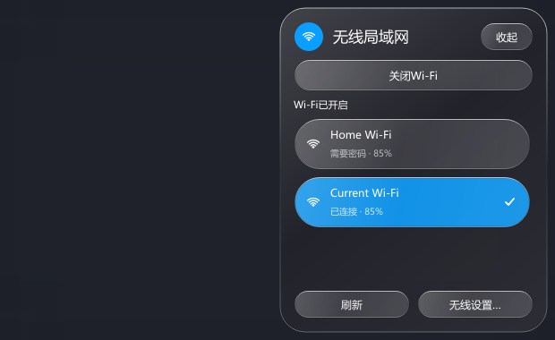
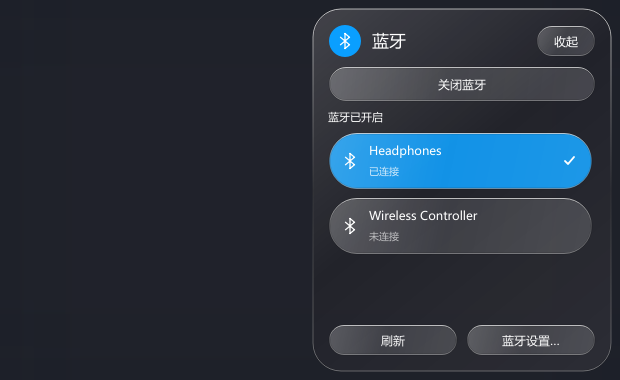

# wisland-connectivity-extension

为 [wisland](https://github.com/AsamiAkito/wisland) 增加统一的 Wi-Fi、蓝牙和 AirDrop 内部展开面板。独立维护的扩展源码，版本 **0.1.0**。

三个面板在原灵动岛窗口内展开，共用玻璃胶囊按钮、连续背景模糊、三弧 Wi-Fi 图标和收起动画，同时只显示一个。AirDrop 来件会切换到接收确认面板。




## 功能范围

- **Wi-Fi**：网络缓存、刷新扫描、信号与连接状态；已保存配置直接连接；新 WPA/WPA2 个人网络可输入密码，开放网络也支持连接。新 WPA3/企业认证转系统设置。密码遮挡且在取消/收起/切层后清空，不写扩展文件、日志或命令行。
- **蓝牙**：已配对的经典/低功耗设备及实际连接状态，电源开关；连接、断开和配对通过面板内的系统设置入口完成。
- **AirDrop**：控制外部 AirDrop 接收端，关闭/所有人10分钟、逐次接收/拒绝、进度及完成提示。扩展自身不包含 AWDL/USB 引擎，源码包需另备兼容接收端；本机完整包已附带独立接收端。

## 安装

适用 Windows x64、wisland 的 Python/PySide6 环境。安装前退出 wisland。

```powershell
.\Install.ps1 -WislandRoot "D:\Apps\wisland"
```

脚本使用宿主的 `.venv\Scripts\python.exe` 安装 `requirements-extension.txt`，然后进行哈希核对、备份和安装。只更新已知扩展文件，不覆盖未知本地修改。

源码包可指定已有 AirDrop 接收端：

```powershell
.\Install.ps1 -WislandRoot "D:\Apps\wisland" -AirDropExecutable "D:\Apps\AirDrop\AirDrop.exe"
```

完整包中的 `runtime/AirDrop/AirDrop.exe` 会被自动发现。保留解压目录；若移动接收端，重新运行安装命令更新位置。位置只写到宿主 `data/extensions/connectivity.json`，不改写主 `config.json`。原有 `airdrop.executable` 配置优先。

只检查、不写文件或安装依赖：

```powershell
.\Install.ps1 -WislandRoot "D:\Apps\wisland" -Check
```

启动 wisland 后，在“控制”页点击相应磁贴。Wi-Fi/蓝牙开关在详情内部；普通打开和定时刷新只读缓存，点击“刷新”才请求 Wi-Fi 扫描。

## 恢复

先退出 wisland，再执行：

```powershell
.\Restore.ps1 -WislandRoot "D:\Apps\wisland"
```

按最新备份逐文件恢复；`-Backup` 可指定 `data/extension-backups/airdrop-*` 下的某次备份。恢复前核对所有当前和备份哈希，文件被改动时停止。只移除本次新增且未变化的扩展文件，保留配置、模型、接收文件和原始日志。

## 兼容性与验证

安装器只接受已验证控制页，SHA256 为 `2920592a75af1471c7b3c49c88f36a5a27a0d387e0130c3da53c846780b7b368`，或者具有已知安装清单的扩展版本。上游更新后会拒绝覆盖，需重新适配。详见 [兼容性](docs/COMPATIBILITY.md)、[验证记录](docs/VALIDATION.md) 和 [许可](docs/THIRD_PARTY.md)。

AirDrop 接收需要 .NET 10 Desktop Runtime、兼容的专用 USB/WinUSB 接收链及可用发现环境。安装脚本不安装驱动或改防火墙；启动宿主不自动开启接收。普通 Wi-Fi/蓝牙面板无需该 USB 接收链。仅接收方向，未实现 Apple 联系人认证。

本仓库不含用户配置、密钥、照片、设备列表、原始日志或实际桌面截图。预览均由虚构数据渲染。

## 测试和打包

```powershell
$env:WISLAND_ROOT = "D:\Apps\wisland"
& "$env:WISLAND_ROOT\.venv\Scripts\python.exe" -B tests/check_extension.py
& "$env:WISLAND_ROOT\.venv\Scripts\python.exe" -B tests/check_connections.py
& "$env:WISLAND_ROOT\.venv\Scripts\python.exe" -B tests/check_packaging.py
python tools/build_package.py
```

`build_package.py` 从已提交文件白名单构建源码 ZIP，可用 `--airdrop-runtime <路径>` 生成本机完整 ZIP。完整包只接受 `runtime-manifest.json` 中哈希相符的程序和许可文件；包内有逐文件校验清单，包外有 SHA256 文件。不复制运行数据。

原创扩展采用 MIT；wisland 上游部分及测试控制页保留 [上游 MIT 许可](LICENSE-wisland.txt)。独立接收端及其第三方组件按各自许可提供，不能把整个完整包统称为 MIT。
